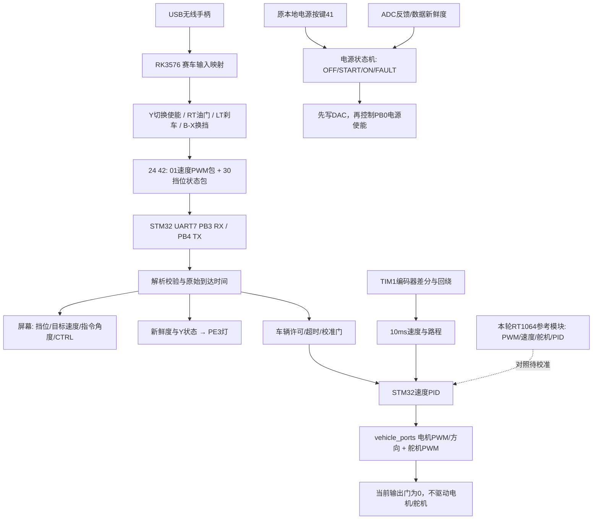

# RT1064四项代码移植参考与流程图

日期：2026-11-07。PMPM按PWM电机驱动理解。本轮不烧录、不启用电机/舵机，不修改vehicle_calibration中的未验证校准值。

## 来源

RT仓库lxqds/rt1064，提交0a87826241f6ceab5c7228bdc8808db77a8519c5，来源为已有review_sources/rt1064审查快照。本次未声称重新拉取远端最新版本。Motor.c、Encoder.c、Servo.c、Pid.c的git hash-object已与旧仓库该提交ls-tree逐一匹配。快照本身没有独立.git，不可用其父项目HEAD作为RT来源提交。

完整原文件及版权声明保存在reference/rt1064_0a878262/，manifest.json含逐文件SHA256；主机main配置另存main_control_1adb020a.json，源提交1adb020a7fc0e34d2aba955a1c4ac64900779348。原代码中商业使用限制声明仍保留。

## 文件级搬迁

|源文件（RT项目路径）|新增/现有STM32文件|处理方式|
|---|---|---|
|project/code/Motor.c、Motor.h|Core/Src/rt1064_reference.c、Core/Inc/rt1064_reference.h|提取目标速度到计数、正反转电平、PWM比例；原文件另存。STM32实际外设仍由vehicle_ports.c的TIM2_CH2/PA1、PA0实现|
|project/code/Encoder.c、Encoder.h|rt1064_reference.c；既有vehicle_core.c|保留距离/速度单位计算；QTIMER读数取负再清零不能直接搬到TIM1累计计数，现有STM32差分回绕逻辑保留|
|project/code/Servo.c、Servo.h|rt1064_reference.c；既有vehicle_ports.c|分别提供串口校正映射和角度函数映射；原C30 PWM改为STM32 TIM5_CH3/PA2外设层，尚未启用|
|project/code/Pid.c、Pid.h|Core/Src/rt1064_pid_reference.c、Core/Inc/rt1064_pid_reference.h|算法符号加RT1064前缀、移除NXP依赖，保留旧算术行为，用于对照测试，不替换当前速度PID|

这两个参考.c已加入Keil主工程并编译，但没有接入VehicleCore输出路径；链接器会裁剪未引用函数，因此当前HEX与上轮电源修复版一致。原始参考目录不参与编译。不能把“代码已搬入”视为“硬件校准、闭环迁移已完成”。

## 1. PWM电机驱动

Motor.c:31实际初始化5kHz，D0 PWM、D1方向。Motor.c:50起先将输入取负，再设置方向；正PID输入最终D1高，负PID输入D1低。Motor.h:9/10限幅±1950，实际pwm_set_duty为绝对值×10。zf_driver_pwm.h:41满量程20000，因此最大19500/20000=97.5%，不是注释95%。移植参考输出permille=abs(output)/2，零输出时方向应忽略；STM32既有外设层还保留换向前零PWM等待。

Motor.h:11旧目标速度上限4m/s；手柄7挡5m/s是新模拟上限，参考函数仍按旧4m/s限幅，未将5m/s写入实车标定。

## 2. 编码器与速度

Motor.c:36..39实赋值：512.0计数、2.7传动比、轮径0.064m。Motor.c:109每10次1ms调度采样；Timer.c:28与isr.c:139连接实际调用链。Encoder.c:41将硬件读数取负，:44算单次距离，:47累计，随后清零硬件；:58传给PID的是计数，不是m/s。

每计数距离 = π×64/(512×2.7) ≈ 0.145444 mm。
速度m/s = 10ms有符号增量×0.0145444；1m/s目标≈68.7549计数/10ms。

512是否已经包含四倍频必须实测每轮计数确认，不能根据头文件注释再乘4。新STM32 TIM1累计计数必须差分处理回绕并确认接线方向，不照搬RT清零法。原符号取负也只是RT接线约定。

## 3. 舵机值与角度：两条路径不得混淆

Servo.c:80..83：50Hz，默认中值1500，左1140，右2000；Flash.c:85..113会从Flash覆盖这些值，旧车实际校准可能不同。PWM归一化满量程20000，50Hz周期20000us，故本处数值恰好等于高脉宽us。

实际串口入口isr.c:213调用SERVO_SetPwmValueCorrect，输出=3000-输入-(中值-1500)，限幅为3000-right到3000-left。默认收到1140→输出1860us，1500→1500us，2000→1000us。串口包没有直接的角度字段。

另一个SERVO_AngleControl（Servo.c:140）先反转角度、限±38，再按两侧不同斜率计算command，最后再做3000-command反转：

|旧角度函数输入|中间command|最终输出高脉宽|
|---|---|---|
|-38°|2000|1000us|
|-19°|1750|1250us|
|0°|1500|1500us|
|+19°|1320|1680us|
|+38°|1140|1860us|

这是源码名义映射，不是实测舵机/车轮角度。当前手柄显示仍用1500-角度×3；不能把该显示公式冒充RT±38映射，更不能在未确认方向/机械限位前直接切换。

## 4. PID参数与实际生效条件

|位置|数值/意义|是否实际启用|
|---|---|---|
|main.c:107|Position_PID；输出±1950；误差限10000；积分限4000；Kp/Ki/Kd=0/0/0|实际启动值|
|isr.c:217..222|收到PID设置命令后，用包内3个float替换增益，误差/积分限仍10000/4000|需收到合法命令才覆盖|
|Pid.h:8..10|2.8/0.5/0.55|头文件常量，未见当前启动调用采用，不能标为当前实车参数|
|上位机main configs/control.json:157..159|8/0.8/0；yyds.cpp:88..90读取并发送|源码配置候选，不证明旧车最后一次已收到|

旧PID误差单位counts/10ms，输出单位为1950尺度，Ki不显式乘dt，Kd是相邻误差差，不直接等于当前m/s、permille、测量微分PID。参考层保留旧行为供对照：Pid_Reset只清输出项不清历史误差；位置式积分判断依赖上次未限幅Out，存在饱和恢复局限。没有将这些旧局限覆盖回当前改进PID。

## 当前源码流程

电源恢复代码是上一轮未烧录改动；本轮保留。Y指示与本地电源使能独立。电机/舵机仍禁用，vehicle_calibration保持calibrated=0、轮距换算/PID/时钟未校准值；未自动启用旧参数。

## 验证

全部纯主机回归通过，新增RT参考测试验证每计数距离、速度换算、4m/s限幅、97.5%最大PWM、两条舵机映射、实际零增益启动、上位机候选增益计算和旧Reset历史误差行为。Keil 0错误3既有警告；新参考模块均编译，未被实际控制引用而被链接裁剪。HEX SHA256 FD3692649980E80A26686377436B1EB3A3B463B8FE5E843FA6909981A7E72D59。未烧录、未动力测试。
